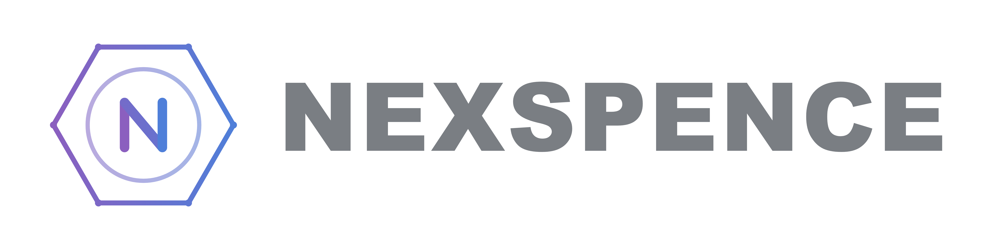

<p align="center">
  
</p>

# nxs

<p align="center">
  <strong>Official CLI for <a href="https://nexspence.com">Nexspence</a> — free, open-source artifact repository manager</strong>
</p>

<p align="center">
  
  
  
</p>

---

`nxs` lets you manage Nexspence repositories, users, and artifacts from the terminal or CI/CD pipelines — with rich output by default and `--json` / `--plain` modes for scripting.

---

## Installation

**macOS / Linux (curl):**
```bash
curl -sSfL https://raw.githubusercontent.com/nexspence/nxs/main/install.sh | sh
```

**Windows (PowerShell):**
```powershell
irm https://raw.githubusercontent.com/nexspence/nxs/main/install.ps1 | iex
```

The Windows installer places the binary in `%LOCALAPPDATA%\Programs\nxs` and adds
it to the user `PATH` — no administrator rights required. It verifies the
archive against the `checksums.txt` published with the release. Pin a version
with `-Version v0.4.0`, or choose the directory with `-InstallDir`.

**Build from source:**
```bash
go install github.com/nexspence/nxs/cmd/nxs@latest
```

---

## Quick Start

```bash
# Authenticate (saves token to ~/.config/nxs/config.yaml)
nxs login --url http://nexspence:8081 --user admin

# List repositories
nxs repo list

# Upload an artifact
nxs push my-raw-repo assets/app-v1.0.tar.gz app-v1.0.tar.gz

# Download an artifact
nxs pull my-raw-repo app-v1.0.tar.gz --output ./downloads

# Search components
nxs search --repo maven-releases --q mylib
```

---

## Commands

### Auth
```
nxs login [--url URL] [--user USER] [--context NAME]   Authenticate and save token
nxs logout                                              Clear token for active context
nxs context list                                        List configured contexts
nxs context use <name>                                  Switch active context
```

### Repositories
```
nxs repo list [--format FORMAT] [--type TYPE]          List repositories
nxs repo create <name> --format FORMAT --type TYPE     Create a repository
nxs repo delete <name> [--force]                       Delete a repository
nxs repo info <name>                                   Show repository details
nxs repo update <name> [--online|--offline]            Change a repository
       [--description TEXT]                            …its description
       [--write-policy allow|allow_once|deny]          …its write policy
       [--allow-redeploy-latest]                       …whether a redeploy is allowed
       [--pull-block-severity LEVEL]                   …the severity that blocks a pull
       [--member NAME]                                 …the members of a group (repeatable)
```

> Only the flags you name are sent: a setting you do not mention stays as it
> is. The settings that belong to a repository's `formatConfig` — the write
> policy, the pull gate, the group members — are sent inside it, which is
> where the server keeps them.

### Artifacts
```
nxs push <repo> <remote-prefix> <local>                Upload a file
       [-r] [--concurrency N] [--continue-on-error]    …a directory or glob (-r)
nxs pull <repo> <remote-prefix> [-o DIR]               Download a file
       [-r] [--concurrency N] [--continue-on-error]    …everything under a prefix (-r)
nxs search [--repo NAME] [--format FMT] [-q QUERY]     Search components
         [--tag KEY=VALUE]
nxs component delete <id> [--force]                    Delete a component and its assets
```

### Users & Roles
```
nxs user list                                          List all users
nxs user create <username> --email EMAIL --password P  Create a user
       [--role ROLE]                                   …and give it a role (repeatable)
nxs user update <username> [--first-name F]             Update a user
       [--last-name L] [--email E] [--role ROLE]       …its profile and its roles (repeatable)
nxs user delete <username> [--force]                    Delete a user
nxs user password <username> --password PASSWORD        Change a user's password
nxs role list                                          List the roles on the server
nxs role create <name>                                 Create a role
nxs role update <name> --name NEW-NAME                 Rename a role
nxs role delete <name> [--force]                       Delete a role
nxs role assign <username> <role>                      Assign a role to a user
nxs role revoke <username> <role>                      Revoke a role from a user
```

> A role is a name here and an id on the wire — the CLI resolves the names to
> the ids the server stores. A role that the server does not know is an error,
> not a silent skip.
>
> The password of a user is a secret: it is never echoed, never printed in the
> `--json` output, and never part of an error message.

### API Tokens
```
nxs token list                                         List your tokens
nxs token create <name> [--expires-days N] [--scope S] Create a token (printed once)
nxs token delete <id>                                  Revoke a token
```

### Promotion
```
nxs promote rules                                      List promotion rules
nxs promote run --rule <name|id>                       Promote components
              --component group:name:version           …by coordinates (repeatable)
              [--component-id UUID]                     …or by raw ID
nxs promote requests [--status STATUS]                 List promotion requests
nxs promote approve <request-id>                       Approve a request
nxs promote reject <request-id> [--reason TEXT]        Reject a request
```

### Operations
```
nxs cleanup list                                         List the cleanup policies
nxs cleanup create <name> [--format FORMAT] [--age D]    Create a cleanup policy
              [--cron EXPR] [--dry-run] [--enabled]      …its schedule and its criteria
              [--retain-versions N] [--repository NAME]
              [--path-prefix PREFIX] [--name-glob GLOB]
nxs cleanup update <name|id> [ …the same options… ]      Change a cleanup policy
nxs cleanup delete <name|id> [--force]                    Delete a cleanup policy
nxs cleanup preview <name|id>                             Show what a policy would remove
nxs cleanup run <policy-name>                             Run a cleanup policy now
nxs blobstore list                                       List blob stores
nxs blobstore info <name>                                Show blob store details
nxs blobstore compact <name> [--dry-run] [--min-age D]   Garbage-collect unreferenced blobs
nxs migrate from <nexus-url> [--user U] [--repos]         Migrate from Nexus
                [--users] [--blobs]
nxs audit [--limit N] [--offset N] [--domain D]          Read the audit log
           [--action A] [--username U] [--from DATE] [--to DATE]
nxs health [--watch]                                     Show server status
```

> `nxs cleanup preview` answers what a policy would remove without removing
> it — the way to find out what a policy does before it runs.

### Output flags (global)
```
--json          Machine-readable JSON output (stdout)
--plain         Tab-separated plain text, no colors
--url URL       Override server URL (env: NXS_URL)
--token TOKEN   Override auth token (env: NXS_TOKEN)
--context NAME  Use named context (env: NXS_CONTEXT)
```

---

## Configuration

`nxs` stores credentials in `~/.config/nxs/config.yaml`:

```yaml
current_context: prod
contexts:
  prod:
    url: https://nexspence.company.com
    token: nxs_abc123
  local:
    url: http://localhost:8081
    token: nxs_xyz789
```

**Environment variables override the config file:**

| Variable | Description |
|----------|-------------|
| `NXS_URL` | Server URL |
| `NXS_TOKEN` | Auth token or JWT |
| `NXS_CONTEXT` | Active context name |
| `NXS_CONFIG` | Path to config file (default: `~/.config/nxs/config.yaml`) |

**Priority:** `--flag` > env var > config file

---

## CI/CD Usage

```bash
# Use env vars — no config file needed in CI
export NXS_URL=https://nexspence.company.com
export NXS_TOKEN=${{ secrets.NXS_TOKEN }}

# Upload build artifact
nxs push releases target/app-1.2.0.jar com/example/app/1.2.0/app-1.2.0.jar

# JSON output for scripting
nxs repo list --json | jq '.[].name'

# Search with plain output for awk
nxs search --repo maven-releases --q mylib --plain | awk '{print $5}'
```

---

## Nexspence Server

`nxs` connects to a running [Nexspence](https://github.com/nexspence/nexspence) instance.

- **Releases:** [github.com/nexspence/nexspence/releases](https://github.com/nexspence/nexspence/releases)
- **Deployment guide:** [docs/deployment.md](https://github.com/nexspence/nexspence/blob/main/docs/deployment.md)

---

## License

AGPLv3 — see [LICENSE](LICENSE)
